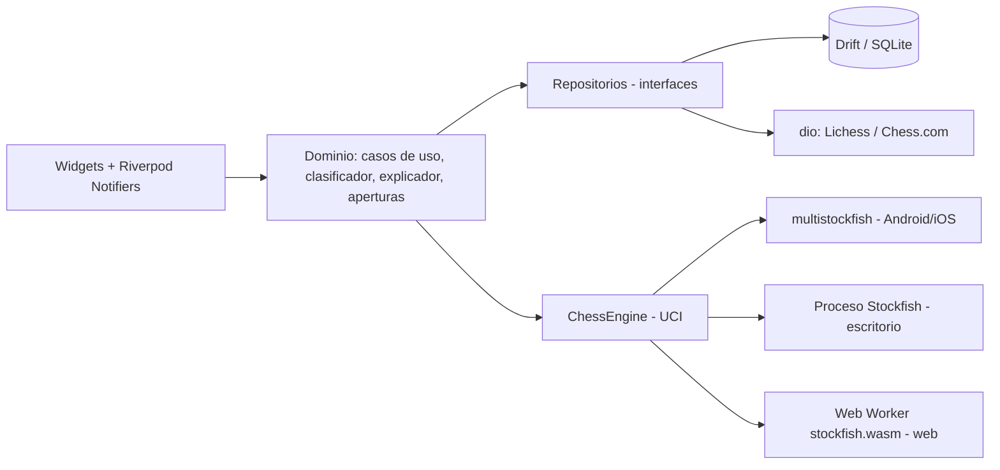

# IraChess — Propuesta técnica (Fase 0)

Estado: **confirmada** (D1–D5 aceptadas; sin CI por petición del usuario). Implementación y desviaciones: ver [ESTADO.md](ESTADO.md).
Versiones y licencias de paquetes comprobadas en pub.dev el 2026-11-26.

---

## 0. Decisiones que necesito que confirmes

| # | Decisión | Propuesta | Por qué importa |
|---|----------|-----------|-----------------|
| D1 | Licencia de IraChess | **GPL-3.0** para toda la app | Stockfish, dartchess, chessground y multistockfish son GPL-3.0: la app entera debe serlo (ver §3). |
| D2 | Web | Solo build **Wasm**, experimental. Si el *spike* falla, la web pasa a Fase 4 y **escritorio** queda como plataforma de iteración rápida | dartchess declara "no soporta web" (usa enteros de 64 bits); en Wasm sí funcionan. |
| D3 | Escala de clasificación | 10 categorías (como tu captura): Brillante, Genial, Teoría, Mejor, Excelente, Buena, Imprecisión, Error, Omisión, Error grave | Añade "Genial" (única jugada) y "Omisión" (no castigaste un error rival) a tu lista; muy útiles en 400–1800. |
| D4 | Alojamiento de paquetes de puzzles | **GitHub Releases** del repo (estático, gratis), generados por un script en CI | La base completa de Lichess son millones de puzzles; no cabe en la app. |
| D5 | Backend de sincronización (Fase 4) | **Supabase** | SDK MIT (compatible con GPL), Postgres + RLS, autoalojable. Se puede decidir en Fase 4. |

Si no dices nada en contra, asumo todo lo de la tabla.

---

## 1. Arquitectura

**Feature-first con capas dentro de cada feature** (presentación / dominio / datos) y un `core/` compartido.
El dominio es Dart puro (sin Flutter) para poder probarlo con `dart test` y ejecutarlo en Isolates.
Riverpod hace de inyección de dependencias: cada repositorio/servicio es un provider sustituible por un *fake* en tests.



```
lib/
  main.dart, app.dart            # MaterialApp.router, tema, l10n
  core/
    chess/                       # utilidades sobre dartchess (repetición, fase, material, SEE)
    engine/                      # ChessEngine (interfaz UCI) + 3 implementaciones + parser UCI
    db/                          # base Drift, tablas, migraciones
    network/                     # dio + reintentos/429
    ui/                          # tema, breakpoints, shell de navegación, widgets comunes
  features/
    games/        (importar PGN, lista de partidas, importadores Lichess/Chess.com)
    analysis/     (servicio de análisis, clasificación, explicaciones, tabla, resumen)
    openings/     (ECO, salida de teoría, estadísticas)
    puzzles/      (banco, paquetes offline, rating, puzzles de mis errores)
    vision/       (entrenamiento de coordenadas)
    progress/     (panel de estadísticas)
    settings/     (ajustes, datos, licencias, cuenta)
l10n/  app_es.arb (plantilla), app_en.arb
tool/  scripts de generación (ECO → JSON, CSV de puzzles → paquetes)
test/  unit + widget;  integration_test/
```

### Flujo de análisis (núcleo)

1. `PgnImporter` valida y sanea el PGN → `Game` (línea principal + cabeceras + relojes `[%clk]`).
2. `AnalysisService` recorre las posiciones; para cada una consulta la **caché** (`position_evals`) y solo pide al motor las que faltan (`go depth D movetime T`, MultiPV 3).
3. Los resultados se emiten como `Stream<AnalysisProgress>` → la UI pinta clasificaciones a medida que llegan. Cancelable con `stop`.
4. Al terminar, `Isolate.run` ejecuta el post-proceso puro: clasificar, detectar motivos tácticos, generar explicaciones, precisión, fases, momentos críticos. Se guarda el resumen.

> Sobre el Isolate: el motor nunca corre en el hilo de la UI (hilos nativos en móvil, proceso aparte en escritorio, Web Worker en web), y la comunicación UCI es asíncrona. Lo que sí es CPU en Dart (motivos tácticos sobre 80+ jugadas) va en `Isolate.run`. En web `Isolate.run` no es un hilo real; ahí se trocea el trabajo para no bloquear frames.

---

## 2. Stack final

| Necesidad | Paquete (versión actual) | Justificación | Descartado |
|-----------|--------------------------|---------------|------------|
| Estado + DI | `flutter_riverpod` 3.5 | Tu preferencia; providers testeables y *overrides* para fakes. Sin generador de código para mantenerlo simple. | Bloc: más ceremonia para el mismo resultado. |
| Navegación | `go_router` 18 | `StatefulShellRoute` da barra inferior / rail / barra lateral conservando el estado de cada pestaña; deep links. | Navigator manual. |
| Reglas, FEN, PGN | `dartchess` 0.15 (GPL-3.0, Lichess) | Usado en producción por la app móvil de Lichess. PGN con variantes y comentarios, SAN/UCI, todas las reglas. | `chess` (puro Dart, sí funciona en JS) — PGN más pobre y menos probado. |
| Tablero | `chessground` 11 (GPL-3.0, Lichess) | Arrastrar y tocar, legales, último movimiento, jaque, flechas/círculos, selector de coronación, animaciones. Reescribirlo con CustomPainter serían miles de líneas. | Tablero propio. **Excepción:** el modo Visión usa una cuadrícula propia de 64 casillas (más simple y accesible). |
| Motor móvil | `multistockfish` 0.7 (GPL-3.0, Lichess) | **Stockfish 19** con red NNUE *light* embebida (~1 MB): sin descargas y app pequeña. Sobrado para 400–1800. | `stockfish` (ArjanAswal): sin variante light. |
| Motor escritorio | Binario oficial Stockfish 19 + `Process.start` (dart:io) | Lo más robusto; mismo protocolo UCI. | `stockfish_chess_engine`: última versión feb-2025. |
| Motor web | stockfish.js/wasm (mono-hilo) en Web Worker vía `package:web` | Multi-hilo exige cabeceras COOP/COEP; mono-hilo funciona en cualquier hosting. | — |
| BD local | `drift` 2.35 (MIT) + `sqlite3` 3.x | SQLite relacional (consultas de estadísticas con SQL), migraciones tipadas, *streams* reactivos, funciona en web (sqlite WASM). | Isar: última versión estable de 2023. |
| Red | `dio` 5.11 | Interceptores para reintentos con *backoff* y 429, cancelación, *streaming* NDJSON (Lichess). | `http`: habría que escribir todo eso. |
| Gráficos | `fl_chart` 1.3 (MIT) | Gráfico de ventaja con toque → jugada; gráficos del panel de progreso. | — |
| i18n | `flutter_localizations` + `intl` + ARB (gen-l10n) | Oficial. Español por defecto, inglés. | — |
| Ajustes | `shared_preferences` | Ajustes no sensibles. `flutter_secure_storage` solo para el token de sync (Fase 4). | — |
| Archivos / compartir | `file_picker`, `share_plus` | Abrir PGN, exportar PGN anotado. | — |
| Vibración | `HapticFeedback` (SDK) | Sin dependencia. | — |
| Sonido (Fase 4) | `audioplayers` + sonidos CC0/propios | Sonidos propios, no los de Chess.com. | — |
| Sync (Fase 4) | `supabase_flutter` (MIT) | Ver D5. Firebase tiene componentes propietarios, problemáticos dentro de una app GPL. | Firebase. |
| Tests | `flutter_test`, `integration_test` (SDK) | Fakes escritos a mano; sin librería de mocks. | — |
| Lints | `flutter_lints` + `strict-casts`, `strict-inference`, `strict-raw-types` | Análisis estricto sin dependencia extra. | — |
| CI | GitHub Actions | `analyze` + `test` + build APK, Linux y web-wasm; iOS en runner macOS sin firma (Fase 4). | — |

---

## 3. Licencias y cumplimiento de la GPL

**Consecuencia principal:** Stockfish, dartchess, chessground y multistockfish son GPL-3.0 y se enlazan en el binario → **IraChess se distribuye como GPL-3.0**. Ventaja: podemos usar el código de Lichess sin problemas.

Cómo se cumple:
- `LICENSE` (GPL-3.0) en el repo y aviso de copyright en cada release.
- **Código fuente disponible**: repo público con una etiqueta git por cada versión publicada (`v1.2.0` = exactamente lo compilado). El repo puede ser privado mientras no se distribuya ningún binario.
- **Dentro de la app**: Ajustes → Acerca de → "Licencias" (`showLicensePage` + `LicenseRegistry` con los textos de Stockfish, dartchess, chessground, ECO y piezas) y un enlace al código fuente, más el aviso de "sin garantía".
- Sin DRM ni restricciones añadidas por nosotros.

Recursos de terceros (solo licencias compatibles):

| Recurso | Fuente | Licencia |
|---------|--------|----------|
| Aperturas ECO (~3.900 líneas, ~400 KB) | `lichess-org/chess-openings` | CC0 |
| Puzzles | Base de puzzles de Lichess | CC0 |
| Piezas | Conjuntos de Lichess **filtrados**: cburnett, merida (GPLv2+), chessnut (Apache-2.0), fantasy/spatial/celtic (MIT), rhosgfx (CC0) | Compatibles con GPL-3.0 |
| Excluidas | staunty, california, maestro, tatiana, etc. | CC BY-NC-SA: no comercial e incompatible con GPL |

Tiendas:
- **Google Play / F-Droid**: sin problema si se cumple lo anterior.
- **App Store**: la FSF considera los términos de Apple incompatibles con la GPL (caso VLC, 2011). En la práctica hay apps GPL con Stockfish publicadas (p. ej. la app de Lichess) y solo los titulares del copyright podrían reclamar. Recomendación: código siempre publicado y **consultar con un abogado antes de publicar en iOS**. Esto no es asesoramiento legal.
- No podemos incluir SDKs propietarios enlazados (analíticas cerradas, etc.).

Identidad propia: nada de marca, textos, iconos, sonidos ni colores de Chess.com (p. ej., no el tablero verde/crema de tu captura).

---

## 4. Modelo de datos (Drift / SQLite)

Principio: **guardar hechos, derivar lo demás**. El rating y las rachas se recalculan desde el historial; así la sincronización no tiene conflictos.

| Tabla | Campos clave | Notas |
|-------|--------------|-------|
| `games` | id, source (`pgn`/`lichess`/`chesscom`/`engine`), externalId, pgn, white, black, result, date, timeControl, userColor, eco, openingName, bookExitPly, createdAt, updatedAt | `UNIQUE(source, externalId)` evita duplicados al reimportar. |
| `position_evals` | epd, engineId, preset, lines (JSON: `[{uci, cp, mate, pv}]` ×3), depth | **Caché por posición**: una apertura común se analiza una sola vez en todas tus partidas. PK `(epd, engineId, preset)`. |
| `game_analyses` | gameId, engineId, preset, status, accuracyWhite, accuracyBlack, counts por clase, por fase, criticalPlies | Resumen para panel y estadísticas. |
| `move_analyses` | gameId, ply, san, uci, fenBefore, winBefore, winAfter, bestUci, classification, motifs, explanationKey, explanationArgs, timeSpentMs, phase | La explicación se guarda como **clave + argumentos**, no texto, para que cambie de idioma. Alimenta filtros, estadísticas y "puzzles de mis errores". |
| `puzzles` | id, fen, moves (UCI), rating, popularity, themes, source (`lichess`/`own`), gameId?, ply?, packId | Índice por rating. |
| `puzzle_themes` | puzzleId, theme | Consultas rápidas por tema. |
| `puzzle_packs` | id, theme, ratingMin, ratingMax, count, bytes, version, downloadedAt | Indicador de espacio y borrado por paquete. |
| `puzzle_attempts` | id (UUID cliente), puzzleId, solved, hintsUsed, timeMs, ratingAfter, attemptedAt, syncedAt | **Solo inserción** → sync idempotente. |
| `vision_sessions` | id (UUID), mode, side, coordsVisible, score, misses, durationMs, startedAt, syncedAt | |
| `vision_misses` | sessionId, target, tapped | Mapa de casillas con más fallos. |

Ajustes (idioma, tema, tablero, piezas, sonido, preset del motor, usuarios de Lichess/Chess.com, objetivo diario, nivel) en `shared_preferences`.

**Sincronización (Fase 4)**: los registros de intentos/sesiones se unen por UUID (sin duplicados ni pérdidas); los datos mutables (metadatos de partidas, ajustes) usan *last-write-wins* por `updatedAt`; los borrados son *tombstones*. El rating y las rachas se recalculan tras sincronizar.

---

## 5. Clasificación de jugadas

Probabilidad de victoria desde los centipeones (fórmula pública de Lichess), siempre desde el punto de vista de quien mueve:

```
W(cp) = 50 + 50 · (2 / (1 + e^(−0.00368208·cp)) − 1)      mate a favor → 100, en contra → 0
ΔW    = W(mejor jugada) − W(jugada hecha)                 (misma profundidad, misma posición)
```

| Clase | Símbolo | Criterio (por orden de evaluación) |
|-------|---------|------------------------------------|
| Teoría | 📖 | La posición resultante está en el libro ECO (solo hasta la primera salida de teoría). |
| Brillante | !! | ΔW ≤ 2, la jugada **sacrifica material** (deja una pieza ≥ alfil con intercambio estático desfavorable que el motor no recupera en 4 medias jugadas), W después ≥ 50 y W antes ≤ 95. No cuenta recapturar. |
| Genial | ! | Es la mejor jugada y la 2.ª opción es ≥ 10 puntos de W peor (única jugada que mantiene el resultado). |
| Mejor | ★ | Coincide con la 1.ª línea del motor. |
| Excelente | ✓✓ | ΔW ≤ 2 |
| Buena | ✓ | ΔW ≤ 5 |
| Imprecisión | ?! | ΔW ≤ 10 |
| Omisión | ✗ | La jugada anterior del rival fue Error o Error grave y no lo castigaste (ΔW > 10, sin llegar a Error grave). |
| Error | ? | ΔW ≤ 20 |
| Error grave | ?? | ΔW > 20 |

- Jugada forzada (una sola legal): sin clasificar.
- Los umbrales son constantes en un único archivo, con tests; se ajustan con partidas reales.
- **Precisión por jugada** (Lichess): `103.1668 · e^(−0.04354·ΔW) − 3.1669`, acotada a [0, 100]. **Precisión de partida**: algoritmo de Lichess (media ponderada por volatilidad + media armónica).
- **Fases**: apertura = hasta salir de teoría o la jugada 10; final = ≤ 6 piezas mayores y menores en total; medio juego = el resto.
- **Momentos críticos**: las 3–5 jugadas con mayor |ΔW|.
- Accesibilidad: cada clase tiene símbolo + color + nombre (no depende solo del color); paleta alternativa para daltonismo.

### Presets del motor (MultiPV 3, se detiene en lo primero que ocurra)

| Preset | Profundidad | Tope por posición | Partida de 40 jugadas (81 posiciones) |
|--------|-------------|-------------------|----------------------------------------|
| Rápido | 12 | 0,25 s | ≤ ~20 s |
| Normal (por defecto) | 16 | 0,6 s | ≤ ~50 s → cumple el "< 1 minuto" |
| Profundo | 20 | 2 s | ≤ ~3 min |

Hilos = núcleos/2 (máx. 4), hash 64 MB. En móvil el análisis se pausa en segundo plano y continúa desde la caché.

---

## 6. Explicaciones en lenguaje sencillo (sin IA, sin conexión)

Detectores de reglas en Dart puro sobre dartchess, aplicados a tu jugada, a la mejor línea del motor y a la **refutación** (la mejor respuesta del rival tras tu jugada):

| Motivo | Detección |
|--------|-----------|
| Pieza colgada | La refutación captura material con intercambio estático favorable al rival. |
| Horquilla | Una pieza ataca a la vez ≥ 2 piezas valiosas o indefensas (incluido el rey). |
| Clavada | Pieza propia en línea entre un atacante de largo alcance y el rey o una pieza más valiosa. |
| Ataque descubierto | Al moverse una pieza, se abre la línea de un alfil/torre/dama sobre un objetivo. |
| Mate en N | Puntuación de mate del motor ("permitiste mate en 2", "tenías mate en 3"). |
| Material gratis no tomado | La mejor jugada captura material que tú no tomaste. |

Salida: `Explanation(clave, argumentos)` → texto traducido con ARB. Ejemplos:
- "Después de **Ad3**, tu rival podía jugar **Cxf7**: una horquilla al rey y la dama."
- "Tu caballo en e5 quedó sin defensa. Era mejor **Cf3**, que lo protege y desarrolla."

Si ningún detector confirma un motivo, se da una explicación genérica basada en la evaluación y la idea de la mejor jugada (captura, jaque, amenaza, desarrollo). **Nunca se inventa un motivo que no se haya comprobado.**

---

## 7. Aperturas

- `tool/build_openings.dart` convierte los TSV de `lichess-org/chess-openings` (CC0) en un asset JSON: `EPD → {eco, nombre}` + el conjunto de todas las posiciones de libro.
- **Identificación**: la última posición de la partida que tiene nombre (por EPD, así cubre transposiciones).
- **Salida de teoría**: primera jugada cuya posición no está en el conjunto de libro. Jugadas de libro = jugadas legales desde la posición anterior que sí llevan a él.
- Limitación: el ECO son líneas con nombre, no un libro completo. Mejora opcional con conexión: explorador de Lichess (Fase 3+).
- **Estadísticas por apertura**: consulta SQL sobre `games` + `game_analyses` (veces jugada, % V/T/D según tu color, precisión media).

---

## 8. Pantallas

Navegación: **barra inferior** (móvil) / **NavigationRail** (tableta) / **barra lateral** (escritorio, ≥ 1000 px) con Analizar · Puzzles · Visión · Progreso · Ajustes.

| Pantalla | Fase | Contenido |
|----------|------|-----------|
| Bienvenida (1.ª ejecución) | 4 (versión mínima en 1) | 3 pasos: qué hace IraChess, elegir nivel, usuarios opcionales. |
| Analizar · Mis partidas | 1 | Lista; estado vacío con "Pega un PGN"; botones Pegar / Abrir archivo / Importar (F3) / Jugar contra el motor (F3). |
| Importar PGN | 1 | Pegar o archivo; errores claros (PGN inválido, línea N); si hay varias partidas, elegir. Pregunta "¿con qué color jugabas?". |
| Partida analizada | 1 | Tablero + barra de evaluación + flechas (tu jugada vs. mejor); tarjeta de la jugada (clase, explicación, mejor + 2 alternativas, **Pruébalo tú**); gráfico de ventaja; pestañas **Jugadas** (tabla con filtros) y **Resumen**. Móvil: vertical con pestañas. Escritorio: lado a lado, teclado ←/→/Inicio/Fin. Deslizar para navegar. |
| Resumen | 1 | Precisión de ambos, conteo por clase, rendimiento por fase, momentos críticos, apertura y salida de teoría, recomendaciones. |
| Puzzles · inicio | 2 | Rating, racha, temas, botón "Mis errores". |
| Resolver puzzle | 2 | Tablero, pista, solución, explicación, siguiente. |
| Paquetes sin conexión | 2 | Descargar por tema/dificultad, espacio usado, borrar. |
| Visión | 3 | Configuración (color, coordenadas, 30/60 s o N aciertos) → sesión → resultado + mapa de fallos + récord. |
| Jugar contra el motor | 3 | Nivel (Skill Level / Elo limitado), al terminar → analizar. |
| Importar de Lichess/Chess.com | 3 | Usuario público, rango de fechas, progreso, errores (usuario no existe, sin red, límite de la API). |
| Progreso | 3 | Precisión en el tiempo, rating de puzzles, aperturas, tipos de error, racha, objetivo diario. |
| Ajustes | 1→4 | Idioma, tema, tablero/piezas, sonido, preset del motor, objetivo diario, exportar/borrar todo, cuenta (F4), Acerca de y licencias. |

Identidad (propuesta, se puede cambiar): primario índigo profundo + acento ámbar; tablero por defecto "pizarra" (gris azulado) con alternativas; tipografía Inter (OFL) embebida; logo propio en Fase 4 (marcador en Fase 1).

---

## 9. Riesgos

| # | Riesgo | Impacto | Mitigación |
|---|--------|---------|------------|
| R1 | dartchess/chessground no soportan web JS | Web no compila con dart2js | Build `--wasm` (Chrome/Edge 119+, Firefox 120+, Safari 18.2+). Spike el primer día; si falla → D2. |
| R2 | Motor distinto por plataforma | 3 integraciones que mantener | Una interfaz `ChessEngine` (UCI por texto) y un solo parser UCI compartido; tests contra un motor falso. Escritorio: binario por SO/arquitectura, firma y notarización en macOS. |
| R3 | Rendimiento en Android de gama baja | Puede pasar de 1 min | Tope de tiempo por posición, resultados progresivos, caché, preset Rápido. Medir en un dispositivo real. |
| R4 | Calidad de "Brillante" y de las explicaciones | Etiquetas que confunden | Criterios conservadores, fixtures de partidas conocidas en tests, motivos solo si se confirman. |
| R5 | Límites de APIs externas | Importaciones fallidas | Chess.com: peticiones en serie + reintento ante 429. Lichess: una petición a la vez, 429 → esperar 60 s; NDJSON en streaming. User-Agent genérico. |
| R6 | Tamaño de la base de puzzles | App enorme | Lote base embebido (~2.000 puzzles, ~200 KB) + paquetes descargables (~5.000 puzzles cada uno) generados en CI (D4). |
| R7 | GPL + App Store | Posible retirada en iOS | §3; revisión legal antes de iOS. |
| R8 | PGN malicioso o enorme | Cuelgues | Límites (2 MB por pegado, 500 partidas por archivo, 600 medias jugadas), eliminar caracteres de control, parser en try/catch, cabeceras mostradas como texto plano. |
| R9 | Lector de pantalla en el tablero | chessground tiene poca semántica | Capa `Semantics` propia: "e4, caballo blanco"; movimiento por lista accesible. |
| R10 | Peso del motor en escritorio | Binario oficial con red grande (decenas de MB) | Aceptable en escritorio; alternativa: compilar la variante light. Se mide en el spike. |

Pesos estimados (a confirmar en el spike): APK por ABI ~10–15 MB con motor light; ECO ~100 KB comprimido; puzzles base ~200 KB.

---

## 10. Plan de la Fase 1 (MVP), tras tu confirmación

1. **Spike**: proyecto Flutter mínimo que analiza una posición con Stockfish en Android (emulador/CI), Linux y web-wasm, y parsea un PGN con dartchess en wasm. Resultado → confirma D2 y R10.
2. Proyecto base: lints estrictos, CI (analyze + test + APK + Linux + web), i18n es/en, tema claro/oscuro, shell de navegación adaptable.
3. Importar PGN (validación, varias partidas, color del usuario) + lista de partidas en Drift.
4. Tablero + navegación (botones, deslizar, teclado) + reglas de tablas (incluida triple repetición).
5. `ChessEngine` + `AnalysisService` (progreso, cancelación, caché).
6. Clasificador, precisión, fases, momentos críticos — **tests unitarios**.
7. Aperturas (script + detección + salida de teoría) — **tests unitarios**.
8. Detectores tácticos + explicaciones es/en — **tests unitarios**.
9. Pantalla de partida: flechas, barra de evaluación, gráfico, tabla con filtros, "Pruébalo tú", resumen — **tests de widgets**.
10. Exportar PGN anotado (`{[%eval]}` + NAG) y compartir.
11. Prueba de integración: PGN → análisis completo con motor falso → tabla y resumen correctos.

Al cerrar la fase entrego: comandos para ejecutar y probar, lista de hecho/pendiente y tests en verde.

---

## 11. Supuestos

- La app la usas tú (un usuario por dispositivo); al importar se te pregunta qué color llevabas (o se deduce del usuario de Lichess/Chess.com).
- "Jugar contra el motor" va en la Fase 3 (junto con los importadores), no en el MVP.
- Identificador de paquete provisional `app.irachess` (cambiable antes de publicar).
- Las explicaciones se generan con reglas, sin IA ni conexión.
- Las partidas en línea, el chat, los torneos, las lecciones y la monetización quedan fuera de alcance.
